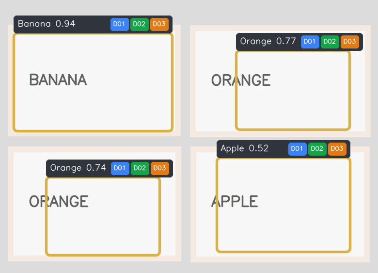

# Warehouse Pallet Vision Demo

**Status: prototype / integration in progress** · **Environment: simulation**

A computer-vision and robotics engineering demonstration for warehouse pallet sorting. The project combines a simulated overhead RGB camera, YOLO object detection, order matching, a local operations dashboard, and a KUKA KR210 pick-and-place simulation. It uses **fictional orders** and is **not** a production warehouse system.

> **Current publication boundary:** The public repository includes the perception, matching, FastAPI/SQLite dashboard and ROS 2 perception code, plus simulation assets and examples. The KUKA control/calibration scripts are not yet published. The full 12-box, YOLO-to-robot workflow is still undergoing validation and is not reproducible from this release alone.

## Screenshots

| Operations dashboard | YOLO detection preview |
| --- | --- |
|  |  |

Screenshots show development/testing states, not measured production performance.

## System overview

```text
Isaac Sim overhead RGB camera
    -> ROS 2 image transport
    -> YOLO perception (class, confidence, 2D bounding box)
    -> driver/client order matching
    -> camera annotations and operations dashboard

Fictional CSV orders -> FastAPI + SQLite -> required/completed/remaining counts

Separate Isaac-side KUKA controller:
    saved pickup/place poses -> simulated transfer -> API count update
    [current controller uses a predefined source sequence;
     YOLO-to-transfer verification is still being integrated]
```

**Perception is not 3D grasp localization.** YOLO provides 2D detections and product classes; the simulated robot uses preconfigured poses. The intended integration associates a visible detection with the expected simulated box before pickup; it does not infer arbitrary 3D grasp poses.

## Technology

- **Python** for shared perception and order-matching logic
- **Ultralytics YOLO11** for RGB object detection
- **ROS 2 Jazzy** for simulated-camera/perception integration
- **NVIDIA Isaac Sim** for warehouse scene and KUKA KR210 simulation
- **FastAPI** for local HTTP endpoints and dashboard serving
- **SQLite** for demo order and completion state
- **HTML / CSS / JavaScript** for the browser dashboard

## Repository layout

- `software/src/whpv_core/` — detector adapter, product/order matching, visualization helpers, shared types
- `software/src/whpv_backend/` — SQLite integration, API, services and dashboard assets
- `software/data/` — fictional CSV scenarios and optional sample/test databases
- `software/tests/` — software and integration tests
- `sim/ros2_ws/src/whpv_perception_ros/` — ROS 2 image/detection/matching adapters
- `sim/isaac_sim/scenes/Worlds/` — Isaac Sim scenes (including `Same_zize_boxes.usd`) and experiments
- `sim/isaac_sim/assets/` — scene textures and labels
- `previews/` — development screenshots

See [`REPOSITORY_STRUCTURE.md`](REPOSITORY_STRUCTURE.md) for the current public file responsibilities.

## Quick start: local dashboard

Prerequisites: Python 3, an environment compatible with `software/pyproject.toml`, and the required packages installed.

```bash
python3 -m venv .venv
source .venv/bin/activate
python -m pip install -e ./software

# Use a new local test database; leave any published sample database unchanged.
export WHPV_CSV_PATH="$PWD/software/data/routes_demo.csv"
export WHPV_DB_PATH="$PWD/software/data/warehouse_local_test.sqlite3"
python -m uvicorn whpv_backend.dashboard_app:app --host 127.0.0.1 --port 8000
```

Open **http://127.0.0.1:8000/dashboard**.

The dashboard uses fictional drivers, clients, orders and products. This quick start is for the **software/backend**, not a one-command launch of Isaac Sim and the robot.

## Tests

With the Python environment active:

```bash
python -m pytest software/tests
```

Some ROS-specific tests/integration paths additionally require a compatible ROS 2 Jazzy environment. Test results and dependencies are being finalized; running the command locally is the source of truth for the current checkout.

## Current status and limitations

- The demo's software includes order requirements and quantity tracking, eligibility/matching and a browser dashboard.
- The ROS perception package and YOLO image pipeline have been developed for the simulation setup.
- The KUKA arm has been used in simulation with saved pickup and placement poses; its control scripts are **not included in this public version**.
- The final **12-box placement run**, error-case verification, and **YOLO-driven pick validation** have **not yet been signed off**.
- The demonstration uses a small set of fruit classes (apple, banana and orange), synthetic product images and fictional orders; these are not representative benchmarks for real warehouse SKUs.
- The code does not provide collision-free motion planning, general 3D localization, verified gripper attachment, or production-grade robotics safety.
- Full end-to-end reproduction will require the separately validated robot scripts and Isaac Sim configuration, which will be added only when ready.

## Scope

This repository is a **portfolio demonstration**, separate from a future **real warehouse vision-assistance MVP**. Any reuse in the real product must be adapted to real cameras, real product catalog/order imports and real-world validation. Simulated automatic transfers are not a required dependency of the eventual worker-assistance product.

## Publication notes

The example data is intended to be fictional. Before publishing new scenes, textures, model weights, or database snapshots, review their provenance, license and contents. No real warehouse/customer data should be committed. A software license for this repository should be chosen explicitly before inviting third-party reuse.
