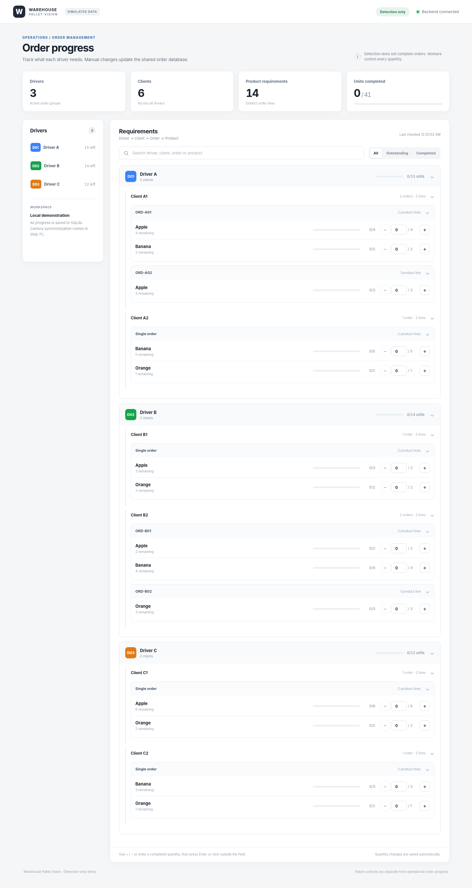
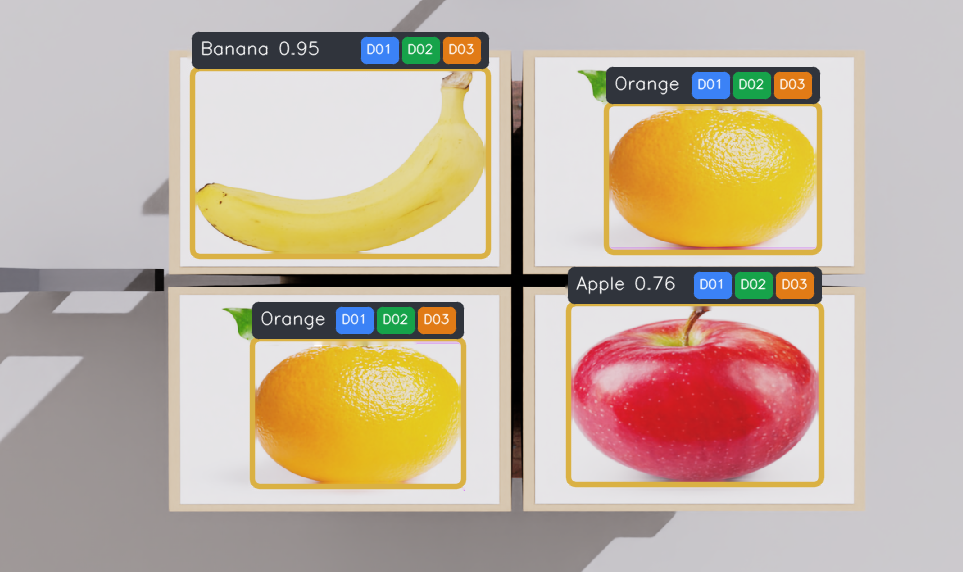

# Warehouse Pallet Vision Demo

**An end-to-end warehouse sorting demonstration in NVIDIA Isaac Sim**  
**ROS 2 Jazzy · YOLO11 · KUKA KR210 · Python · FastAPI · SQLite**

A simulated warehouse workflow that connects overhead-camera product detection, live order eligibility, robot pick-and-place execution, and a browser-based operations dashboard.

The recorded demonstration sorts **12 labeled boxes** from a three-layer incoming pallet to **three outgoing driver pallets (four boxes per driver)**. The system validates each expected product using fresh YOLO detections before executing a transfer, selects the destination from outstanding order requirements, and updates the corresponding completed quantity through the API.

> **Scope:** This is a controlled, reproducible **simulation/portfolio demonstration**, not a production warehouse robot or a general-purpose autonomous picking system. Robot pickup and placement poses are predefined; YOLO supplies product recognition and 2D image detections, not 3D grasp coordinates.

## Demonstration videos

**[Watch the demonstration recordings — GitHub Release `v1.0-demo`](https://github.com/JanCuesta/warehouse-pallet-vision-demo/releases/tag/v1.0-demo)**

The release includes recordings of:

1. **Full warehouse sorting:** KUKA transfers boxes from the incoming pallet to the three driver pallets while the order dashboard tracks completion. A shorter/compressed recording is also available for easier viewing.
2. **Live order matching:** changes to the API's required/completed quantities update the driver eligibility displayed on the annotated camera feed, without changing YOLO's underlying product labels.

The videos were captured on a resource-constrained laptop. A shorter recording was compressed for sharing, which can also reduce the clarity of on-screen labels. See [Recording and perception limitations](#recording-and-perception-limitations) for why some bounding-box overlays update intermittently.

## Screenshots

<table>
  <tr>
    <td align="center">
      <strong>Operations dashboard — drivers, customers, required and completed quantities</strong><br>
      
    </td>
  </tr>
  <tr>
    <td align="center">
      <strong>YOLO product detection and live driver eligibility overlay</strong><br>
      
    </td>
  </tr>
</table>

*Screenshots illustrate the simulation and interface; they are not real-world perception benchmarks.*

## System architecture

```text
                     ISAAC SIM
         Overhead RGB camera (1280 x 720)
                           |
                     ROS 2 image
                           |
                      YOLO11n
                   (2D detections)
                    /            \
                   v              v
        ROS 2 order matcher    YOLO JSON snapshot
                |                    |
        Live FastAPI/SQLite          |
        order requirements           |
                |                    |
                v                    v
      Driver eligibility overlay   Isaac Sim KUKA controller
      (annotated ROS image)         (vision check, fixed poses)
                                          |
                                Simulated pick and place
                                          |
                                 API completion update
                                          |
                                  Browser dashboard
```

**Two different decisions are involved:**

- **Vision verification:** The controller checks that the expected product class is detected in the designated region of the overhead image before picking. The configured check requires **two fresh matching YOLO messages** and a minimum confidence of **0.50**.
- **Order-based routing:** FastAPI/SQLite supplies remaining customer requirements. The controller assigns the next box to an eligible driver with capacity and uses that driver's next available pallet slot. The overlay displays the eligible drivers for each detected product.

The order requirements can change between runs without rewriting the robot's destination assignment logic, provided the totals match the available simulated inventory and pallet capacity.

## Demonstrated scenario

| Incoming inventory | Quantity |
| --- | ---: |
| Apple boxes | 4 |
| Banana boxes | 4 |
| Orange boxes | 4 |
| **Total** | **12** |

The incoming pallet has **three layers of four boxes**. The KUKA processes a known, top-to-bottom source sequence. **Driver A, Driver B, and Driver C each have four predefined destination slots** (`01` through `04`). The recorded demonstration exercised the complete 12-box sequence; movements and order-count updates were checked in the simulated scene and dashboard.

Two fictional order scenarios are provided:

- [`software/data/routes_demo.csv`](software/data/routes_demo.csv) — original requirements.
- [`software/data/routes_alternative.csv`](software/data/routes_alternative.csv) — a different product allocation across the same three drivers, still totaling four apples, four bananas, and four oranges.

## Quick start: full simulation

### Requirements

- **Ubuntu 24.04**, **Python 3.12**, and **ROS 2 Jazzy** (including `rclpy`, `sensor_msgs`, `cv_bridge`, and `colcon`).
- A working **NVIDIA Isaac Sim** installation capable of opening the included USD scene. The demonstration was developed with Isaac Sim 6.1; other versions may require adaptation.
- Sufficient GPU/CPU resources for Isaac Sim, ROS 2 image transport, YOLO inference, and the dashboard. Hardware performance significantly affects the live visual output.
- Internet access may be required on first use to retrieve the public `yolo11n.pt` weights.

The installer sets up this project's Python virtual environment and builds the ROS 2 perception package. It **does not install ROS 2, Isaac Sim, GPU drivers, or the operating system**. It has been exercised on the development machine, not validated across arbitrary hardware configurations.

### Install

The demonstration scripts currently expect this checkout path:

```bash
mkdir -p ~/projects
cd ~/projects
git clone https://github.com/JanCuesta/warehouse-pallet-vision-demo.git
cd warehouse-pallet-vision-demo

./scripts/setup_demo.sh
./scripts/launch_demo.sh --check
```

`setup_demo.sh` uses a ROS-compatible Python environment (including the **NumPy 1.26.4 / OpenCV 4.10** combination used to avoid a `cv_bridge` binary-compatibility crash).

### Start services

```bash
cd ~/projects/warehouse-pallet-vision-demo
./scripts/launch_demo.sh --no-isaac
```

The launcher starts **five services**: FastAPI, YOLO, the detection-snapshot bridge, the order matcher, and the annotated-image overlay. It uses a **fresh temporary SQLite demo database** by default and prints service log locations. Keep it running during the demonstration.

- Dashboard: <http://127.0.0.1:8000/dashboard>
- YOLO detections: `/warehouse/perception/detections_json`
- Driver overlay image: `/warehouse/visualization/driver_overlay`
- Latest YOLO snapshot: `sim/isaac_sim/reports/yolo_latest.json` (generated locally)

To view the annotated image, source the ROS 2 workspace in another terminal and open `rqt_image_view` (if installed):

```bash
source /opt/ros/jazzy/setup.bash
source ~/projects/warehouse-pallet-vision-demo/sim/ros2_ws/install/setup.bash
ros2 run rqt_image_view rqt_image_view
```

Select `/warehouse/visualization/driver_overlay` in the image viewer.

### Run the KUKA controller

1. Open `sim/isaac_sim/scenes/Worlds/IsaacSim_demonstration.usd` in **Isaac Sim**.
2. Press **PLAY** briefly to let the camera publish images. Check that the YOLO snapshot is being refreshed, then press **STOP**.
3. Disable **Robot Poser Track Target** to avoid conflicting robot control.
4. Open `sim/isaac_sim/scripts/demonstration_script.py` in **Isaac Sim's Script Editor**.
5. Confirm `MAX_TRANSFERS = 12`, `PLAN_ONLY = False`, and `VISION_ENABLED = True`; execute the script from Script Editor. It starts its own simulation timeline.
6. Observe the dashboard and outgoing pallets. The intended completed state is **4/4 boxes for each of Drivers A, B, and C**.

**Do not save the USD scene after moving the boxes.** Reopen the saved initial scene before starting another full run, and use a fresh database so simulated physical state and order counts agree.

To run the alternative order scenario, stop the launcher and start it with:

```bash
cd ~/projects/warehouse-pallet-vision-demo
WHPV_CSV_PATH="$PWD/software/data/routes_alternative.csv" \
  ./scripts/launch_demo.sh --no-isaac
```

## Technical limitations

### Predefined robot motion

The controller uses **saved pickup poses for the known boxes** and **four saved placement poses per driver** (12 outgoing slots in total), with joint-space motion between poses. The pickup order, box positions, stacking geometry, and working scene are known in advance. This is not arbitrary-object localization, dynamic grasp-pose generation, general collision-free trajectory planning, or a reusable robotic palletizer for unknown scenes.

YOLO is used to **verify the expected visible product before a predefined pick**, not to calculate the robot's pickup coordinates. The simulator's gripper and commanded motion are not an independent measurement of attachment, successful grasp, or safe physical contact. API quantities are updated after the controller completes its commanded transfer sequence, rather than after an external physical-placement sensor confirms success.

### Recording and perception limitations

The demonstration was recorded on a laptop with limited compute headroom for simultaneously running Isaac Sim, camera rendering, ROS 2, YOLO, and screen recording. Under this load, simulation real-time performance and frame processing can lag. In the videos, bounding-box annotations can therefore **appear late, update intermittently, or temporarily disappear**.

**A missing overlay on a particular video frame is not, by itself, evidence that YOLO failed to detect the object.** The detection stream, order-matching output, and rendered overlay are separate stages, and their display timing may differ. The project has produced live YOLO detection messages for the visible products, and the controller requires fresh product detections before proceeding with a pick. However, this is **not** a claim that YOLO detects every object on every frame or that the system has been benchmarked for recall, latency, or continuous real-time operation. Some individual frames can genuinely be missed or fall below the confidence threshold.

The overhead RGB setup provides **2D bounding boxes and product classes only**. It does not estimate general 3D object poses or handle arbitrary occlusion, product packaging, lighting, or camera geometry.

### Scope and operational safety

- **Simulation only:** No validation on a physical KUKA KR210 or real warehouse equipment.
- **Fixed inventory and capacity:** Three fruit classes, 12 known boxes, three drivers, four slots per driver. A different CSV must remain feasible for those physical constraints.
- **Controlled environment:** No guarantee of collision-free motion, industrial safety interlocks, recovery from dropped objects, or production fault handling.
- **Demo state:** Fictional orders are stored in SQLite; this is not a commercial order-management integration.
- **Reproducibility:** The installation workflow has been tested on the development system. USD references, installed Isaac Sim version, ROS version, and host hardware can affect clean-clone execution.

## Project structure

```text
scripts/
  setup_demo.sh                     # Python environment + ROS 2 build
  launch_demo.sh                    # Backend + YOLO + bridge + matcher + overlay
software/
  data/                             # Fictional order scenarios
  src/whpv_core/                    # YOLO adapter and visualization helpers
  src/whpv_backend/                 # API, SQLite, dashboard, matching service
  tests/                            # Python software tests
sim/
  isaac_sim/
    scenes/Worlds/IsaacSim_demonstration.usd
    scripts/demonstration_script.py  # Isaac Sim KUKA controller
    assets/                          # Scene assets and textures
  ros2_ws/
    src/whpv_perception_ros/        # ROS 2 perception/matching/overlay nodes
    scripts/whpv_yolo_snapshot_bridge.py
previews/                           # Dashboard and annotated-camera screenshots
```

Generated logs, local model weights, database files, and YOLO snapshots are runtime artifacts, not part of the published demonstration source.

## Tests

For available Python software tests, activate the installed environment and run:

```bash
source .venv/bin/activate
python -m pip install pytest
python -m pytest software/tests
```

The ROS 2/Isaac Sim integration should additionally be checked using the live camera, overlay, YOLO snapshot, controller log, and driver quantities. The demonstration videos are visual evidence, not a substitute for automated acceptance tests or hardware validation.

## Project boundary

This repository is a **public robotics and computer-vision portfolio demonstration**. It is separate from any future real-world warehouse-assistance product, which would require independently designed hardware interfaces, item data, operational workflows, and field validation. All sample orders are fictional.
